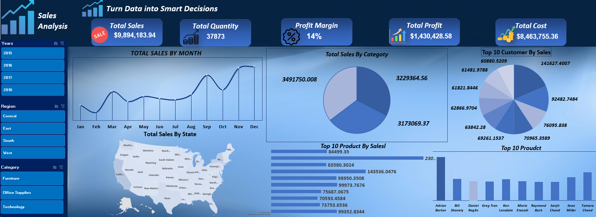

# 📊 Superstore Sales Analysis Dashboard | Excel

<p align="center">
  <b>Interactive Sales Analysis Dashboard built with Microsoft Excel</b>
</p>

---

## 📌 Project Overview

This project showcases an interactive **Superstore Sales Analysis Dashboard** developed using Microsoft Excel to analyze business performance across the United States.

The dashboard transforms raw sales data into meaningful business insights, providing a clear overview of sales trends, profitability, customer behavior, product performance, and geographic distribution.

## 🎯 Project Objectives

- Analyze overall sales, profit, and business performance.
- Identify monthly sales trends and seasonality.
- Evaluate sales performance across product categories.
- Identify top-performing customers and products.
- Analyze geographic sales distribution across US states.
- Track key performance indicators (KPIs).
- Support data-driven business decisions through interactive visualizations.

## 📈 Dashboard Preview

<p align="center">
  
</p>

## 📊 Key Performance Indicators (KPIs)

| KPI | Value |
|---|---:|
| Total Sales | $9,894,183.94 |
| Total Quantity | 37,873 |
| Total Profit | $1,430,428.58 |
| Total Cost | $8,463,755.36 |
| Profit Margin | 14% |

## 📉 Dashboard Features

### 1. Sales Performance Analysis
- Monthly Sales Trends.
- Sales by Product Category.
- Top 10 Customers by Sales.
- Top 10 Products by Sales.

### 2. Geographic Analysis
- Sales distribution across different US states.
- Identification of high-performing geographic markets.

### 3. Interactive Dashboard
Dynamic filtering using Excel Slicers:
- Year
- Region
- Category

Users can interact with the dashboard to explore different business dimensions and analyze performance.

## 🛠️ Tools & Technologies

- Microsoft Excel
- Pivot Tables
- Pivot Charts
- Excel Slicers
- Data Analysis
- Data Visualization

## 💡 Business Insights

The dashboard helps identify:

- Overall sales and profitability performance.
- Monthly sales trends and seasonal patterns.
- Revenue contribution across product categories.
- Top-performing customers and products.
- Geographic differences in sales performance.

## 📁 Project Structure

```text
Superstore-Sales-Analysis-Excel/
│
├── Dashboard.xlsx
├── Sales-Dashboard.png
└── README.md
```

## 👨‍💻 Author

**Ammar Shouib**

🎓 Artificial Intelligence Student  
📊 Aspiring Data Analyst

---

⭐ If you find this project useful, feel free to star this repository!

💬 Feedback and suggestions are always welcome.
